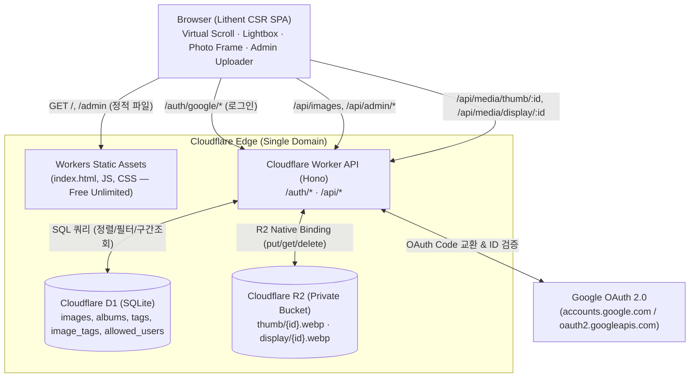

# r2album 아키텍처 및 상세 설계서 (DESIGN)

> 관련 문서: [`REQUIREMENTS.md`](./REQUIREMENTS.md) | [`IMPLEMENT.md`](./IMPLEMENT.md) | [`MANUAL_TEST_CHECKLIST.md`](./MANUAL_TEST_CHECKLIST.md)

---

## 1. 시스템 아키텍처 개요

`r2album`은 단일 Cloudflare Workers 배포 단위로 정적 CSR SPA(`lithent`)와 서버리스 API(Hono)를 함께 서빙합니다.



### 디렉토리 구조 (제안)
```text
r2album/
├── docs/
│   ├── REQUIREMENTS.md
│   ├── DESIGN.md
│   ├── IMPLEMENT.md
│   └── MANUAL_TEST_CHECKLIST.md
├── migrations/
│   └── 0001_init.sql
├── src/
│   ├── shared/                 # 클라이언트/워커 공용 타입·상수·유틸
│   │   ├── types.ts
│   │   └── constants.ts
│   ├── worker/                 # Cloudflare Worker (Hono API)
│   │   ├── index.ts            # 라우터 조립 및 에러 핸들러
│   │   ├── env.ts              # Bindings 타입 (DB, MEDIA_BUCKET, Secrets)
│   │   ├── auth/
│   │   │   ├── google.ts       # OAuth URL 생성, 코드 교환, userinfo/ID 검증
│   │   │   ├── session.ts      # HMAC-SHA256 HttpOnly 쿠키 서명/검증
│   │   │   └── middleware.ts   # requireAuth, requireAdmin
│   │   └── routes/
│   │       ├── auth.ts         # /auth/google, /auth/callback, /auth/logout, /api/me
│   │       ├── images.ts       # /api/images (구간조회), /api/images/ids (롤링용), /api/filters
│   │       ├── media.ts        # /api/media/:variant/:id (Private R2 스트리밍)
│   │       └── admin.ts        # /api/admin/images (업로드/수정/삭제), albums, users, stats
│   └── client/                 # Lithent CSR SPA
│       ├── index.tsx           # 엔트리 + 클라이언트 라우터 (/, /admin, /login)
│       ├── api/                # Typed fetch wrapper
│       ├── stores/             # lstore / store (인증, 필터, 청크 캐시)
│       ├── lib/
│       │   ├── exif.ts         # 경량 EXIF DateTimeOriginal & Orientation 파서
│       │   ├── imageResize.ts  # Canvas WebP 변환 (2048px display + 480px thumb)
│       │   ├── virtualGrid.ts  # 반응형 컬럼·행·청크 범위 순수 계산 로직
│       │   └── shuffle.ts      # Fisher-Yates 중복 없는 셔플 큐
│       └── components/
│           ├── LoginView.tsx
│           ├── GalleryView.tsx
│           ├── VirtualGrid.tsx
│           ├── FilterBar.tsx
│           ├── LightboxModal.tsx
│           ├── PhotoFrameMode.tsx
│           └── admin/
│               ├── AdminView.tsx
│               ├── UploadDropzone.tsx
│               ├── ImageManageTable.tsx
│               ├── AlbumManager.tsx
│               └── UserAllowlistManager.tsx
├── index.html
├── package.json
├── tsconfig.json
├── vite.config.ts
└── wrangler.jsonc
```

---

## 2. 설계 결정 체크리스트 (Decision Checklist)

| ID | 상태 | 결정 항목 | 선택안 / 제안 및 근거 | 검증 연결 |
|---|---|---|---|---|
| `DC-1` | [x] | **렌더링 전략** | **CSR SPA + Cloudflare Workers 올인원** 확정. 비공개 앱이라 SEO가 불필요하며, 정적 SPA 파일은 CDN 무료 서빙으로 서버 연산·트래픽을 최소화함. | `Phase 1`, `M-10` |
| `DC-2` | [x] | **이미지 저장 포맷/해상도** | **브라우저 EXIF 추출 + 표시용 WebP(`max 2048px`, `q=0.82`) + 썸네일 WebP(`max 480px`, `q=0.75`)** 확정. 원본 미보관으로 장당 ~300KB 수준(10GB 기준 약 3만 장+) 달성. | `Phase 4`, `M-4` |
| `DC-3` | [x] | **허용 사용자 관리 방식** | **확정: `BOOTSTRAP_ADMIN_EMAIL` 환경변수 + D1 `allowed_users` 테이블 + `/admin` UI 관리.** 최초 관리자 1명만 환경변수에 두고, 추가 `admin`/`viewer` 이메일은 재배포 없이 `/admin`에서 즉시 초대/해제 가능하도록 함. | `Phase 2`, `Phase 4`, `M-2`, `M-9` |
| `DC-4` | [x] | **Private R2 이미지 서빙** | **Worker 스트리밍 (`/api/media/:variant/:id`) + `Cache-Control: private, max-age=31536000, immutable`** 확정. 세션 쿠키 검증으로 비공개 유지하면서 고정 URL(UUID) 덕분에 브라우저 캐시 히트율 극대화. | `Phase 3`, `M-3` |
| `DC-5` | [x] | **업로드 전송 경로** | **확정: Worker R2 네이티브 바인딩 업로드(`POST /api/admin/images`, multipart로 thumb+display+metadata 전송, 클라이언트 동시성 3 큐).** WebP 변환 후 장당 ~300KB로 매우 가벼워 Worker 제한 대비 안전하고, R2 S3 Secret Key 별도 관리가 불필요하며 R2+D1 원자적 롤백이 단순함. | `Phase 3`, `Phase 4`, `M-4` |
| `DC-6` | [x] | **EXIF 우선 정렬 키** | D1에 `taken_at INTEGER NOT NULL`(epoch ms; EXIF `DateTimeOriginal` 우선, 없으면 `uploaded_at` 동일값), `has_exif_date INTEGER NOT NULL` 저장. 복합 인덱스 `(taken_at DESC, id DESC)`로 안정적인 구간 페이징 보장. | `Phase 3`, `M-4`, `M-6` |
| `DC-7` | [x] | **Virtual Scroll 구간 Fetch** | 고정 청크 크기 **`CHUNK_SIZE = 40`** 기준. 뷰포트에 걸리는 `[startIndex, endIndex]`를 청크 번호로 변환해 미캐시 청크만 `/api/images?offset=...&limit=40` 요청(overscan ±1청크). 필터 변경 시 캐시 초기화. | `Phase 5`, `M-6` |
| `DC-8` | [x] | **액자 롤링 전환 및 셔플** | **2-레이어 더블 버퍼(`slotA`/`slotB`)** 로 다음 이미지 `new Image()` 프리로드 완료 후 CSS `opacity` 크로스페이드(+ 선택적 Ken Burns). 랜덤 모드는 `/api/images/ids`로 받은 필터 범위 전체 ID에 Fisher-Yates 셔플 큐 적용. | `Phase 6`, `M-8` |
| `DC-9` | [x] | **Lithent 컴포넌트/테스트 규약** | 복잡한 상태 컨테이너(`VirtualGrid`, `PhotoFrameMode`, `UploadDropzone`)는 `mount`+`state`, 단순 UI는 `lmount`+`lstate` 사용(컴포넌트 내 모드 혼용 금지). 모든 리스트 `key` 필수. 테스트는 `vitest` + `lithent/test` + `@testing-library/dom`. | `Phase 4~7` |
| `DC-10` | [x] | **로컬 개발 서버 구성** | **확정: `wrangler.jsonc` Static Assets + 개발 시 `vite`(프론트 HMR, `/api` 및 `/auth`를 `wrangler dev`로 프록시) 병행 실행.** Vite 8 + `@lithent/lithent-vite` 조합의 플러그인 호환성 위험을 피하면서, 배포 시에는 `vite build` → `wrangler deploy`로 단일 Cloudflare Worker에 통합됨. | `Phase 1`, `M-10` |
| `DC-11` | [x] | **OAuth 가입 신청 & 관리자 승인 플로우** | **확정: `allowed_users`에 `status('pending' \| 'approved' \| 'rejected')`와 `name` 컬럼 추가(`migrations/0002_user_approval.sql`).** 미등록 Google 계정이 OAuth 콜백에 도달하면 대기열 상한(`MAX_PENDING_USERS = 100`) 내에서 `status='pending'`으로 자동 등록 후 `/login?status=pending` 리다이렉트(세션 쿠키 미발급). `approved` 상태만 세션 발급·API 허용. | `Phase 2`, `Phase 3`, `Phase 4`, `M-11` |

---

## 3. 데이터 모델 (Cloudflare D1 — SQLite)

```sql
-- migrations/0001_init.sql

CREATE TABLE allowed_users (
  email TEXT PRIMARY KEY,              -- 소문자 정규화 이메일
  name TEXT NOT NULL DEFAULT '',       -- Google OAuth 표시 이름 (migrations/0002_user_approval.sql)
  role TEXT NOT NULL CHECK (role IN ('admin', 'viewer')),
  status TEXT NOT NULL DEFAULT 'approved' CHECK (status IN ('pending', 'approved', 'rejected')),
  note TEXT DEFAULT '',
  created_at INTEGER NOT NULL,
  updated_at INTEGER NOT NULL DEFAULT 0
);

CREATE TABLE albums (
  id TEXT PRIMARY KEY,                 -- UUID v4 또는 nanoid
  name TEXT NOT NULL UNIQUE,
  description TEXT DEFAULT '',
  created_at INTEGER NOT NULL,
  updated_at INTEGER NOT NULL
);

CREATE TABLE images (
  id TEXT PRIMARY KEY,                 -- UUID v4 (R2 키 식별자 겸용)
  album_id TEXT REFERENCES albums(id) ON DELETE SET NULL,
  caption TEXT DEFAULT '',
  original_filename TEXT NOT NULL,
  taken_at INTEGER NOT NULL,           -- EXIF 촬영일 우선 (epoch ms), 없으면 uploaded_at
  has_exif_date INTEGER NOT NULL DEFAULT 0, -- 1: EXIF 추출 성공, 0: 업로드 시각 대체
  uploaded_at INTEGER NOT NULL,        -- 업로드 시각 (epoch ms)
  uploaded_by TEXT NOT NULL,           -- 업로더 이메일
  width INTEGER NOT NULL,              -- 표시용 이미지 가로 px
  height INTEGER NOT NULL,             -- 표시용 이미지 세로 px
  display_key TEXT NOT NULL,           -- 예: display/{id}.webp
  thumb_key TEXT NOT NULL,             -- 예: thumb/{id}.webp
  display_bytes INTEGER NOT NULL,
  thumb_bytes INTEGER NOT NULL
);

CREATE TABLE tags (
  id INTEGER PRIMARY KEY AUTOINCREMENT,
  name TEXT NOT NULL UNIQUE            -- 소문자/트림 정규화 태그명
);

CREATE TABLE image_tags (
  image_id TEXT NOT NULL REFERENCES images(id) ON DELETE CASCADE,
  tag_id INTEGER NOT NULL REFERENCES tags(id) ON DELETE CASCADE,
  PRIMARY KEY (image_id, tag_id)
);

-- 핵심 조회 인덱스
CREATE INDEX idx_images_taken_desc ON images (taken_at DESC, id DESC);
CREATE INDEX idx_images_album_taken_desc ON images (album_id, taken_at DESC, id DESC);
CREATE INDEX idx_image_tags_tag ON image_tags (tag_id, image_id);
```

### R2 오브젝트 키 규칙
- 표시용 WebP: `display/{imageId}.webp`
- 썸네일 WebP: `thumb/{imageId}.webp`
- 이미지 수정 시 바이너리를 덮어쓰지 않고 불변(immutable) ID를 유지하므로, 브라우저 HTTP 캐시 무효화 문제가 발생하지 않습니다.

---

## 4. 인증 및 보안 계약 (Google OAuth 2.0 + RBAC)

### 4.1 OAuth 흐름
1. `GET /auth/google`:
   - 랜덤 `state` (CSRF 방지) 및 PKCE `code_verifier`/`code_challenge` 생성.
   - 짧은 만료(10분)의 `HttpOnly; SameSite=Lax; Secure` 임시 쿠키에 `state` + `code_verifier` 저장 후 Google OAuth 인가 URL로 리다이렉트 (`scope=openid email profile`).
2. `GET /auth/google/callback`:
   - 쿼리 `state`와 쿠키 `state` 일치 검증.
   - Google Token Endpoint로 `code` + `code_verifier` + `GOOGLE_CLIENT_ID` + `GOOGLE_CLIENT_SECRET` 교환.
   - ID Token / UserInfo에서 `email`, `email_verified === true`, `name`, `picture` 검증.
   - 허용 목록 확인 (`DC-11`):
     - `email.toLowerCase() === env.BOOTSTRAP_ADMIN_EMAIL.toLowerCase()` → `role = 'admin'` 즉시 로그인 허용.
     - D1 `allowed_users`에 `status = 'approved'`로 존재 → 해당 `role`로 로그인 허용.
     - `status = 'rejected'`로 존재 → 세션 쿠키 없이 `/login?error=rejected` 리다이렉트.
     - `status = 'pending'`으로 이미 존재 → 세션 쿠키 없이 `/login?status=pending` 리다이렉트.
     - 미등록 신규 계정 → `pending` 건수가 `MAX_PENDING_USERS(100)` 미만이면 `(email, name, role='viewer', status='pending', created_at=now, updated_at=now)` 등록 후 `/login?status=pending` 리다이렉트; 상한 초과 시 `/login?error=signup_closed` 리다이렉트.
   - 서명된 세션 토큰(JWT 또는 HMAC-SHA256 Payload: `{ email, role, name, exp }`, 유효기간 7일)을 `HttpOnly; SameSite=Lax; Secure; Path=/` 쿠키(`r2album_session`)로 설정 후 `/`로 리다이렉트.
3. `POST /auth/logout`:
   - `r2album_session` 쿠키 즉시 만료 처리.

### 4.2 접근 제어 정책
- `/auth/*`, `/api/me`: 비로그인 허용 (`/api/me`는 미로그인 시 `{ authenticated: false }` 반환).
- `/api/images*`, `/api/filters`, `/api/media/*`: **`requireAuth`** (`admin` 또는 `viewer` 필수, 미인증 시 `401`).
- `/api/admin/*`: **`requireAdmin`** (`role === 'admin'` 필수, 미인증 `401`, `viewer`는 `403`).
- 정적 SPA 라우트(`/`, `/admin`): SPA 껍데기만 반환하며, 실제 데이터/이미지는 인증 API를 통해서만 로드된다. `/admin` 진입 시 클라이언트에서 `role !== 'admin'`이면 `/`로 리다이렉트하고, 서버에서도 모든 변경 API를 `requireAdmin`으로 강제 차단한다.

---

## 5. HTTP API 계약

### 5.1 인증 & 필터 조회 (Authenticated)
| Method | Endpoint | 설명 | 응답 핵심 필드 |
|---|---|---|---|
| `GET` | `/api/me` | 현재 세션 및 권한 조회 | `{ authenticated, user?: { email, name, role } }` |
| `GET` | `/api/filters` | 앨범 목록(이미지 수 포함) + 태그 목록(이미지 수 포함) | `{ albums: AlbumSummary[], tags: TagSummary[], totalImages }` |
| `GET` | `/api/images` | 구간별 이미지 메타데이터 조회 (`?offset=0&limit=40&albumId=&tag=`) | `{ total, offset, limit, items: ImageItem[] }` |
| `GET` | `/api/images/ids` | 액자 롤링용 필터 범위 전체 ID/메타 경량 목록 (`?albumId=&tag=`) | `{ total, items: FrameItem[] }` (`id, caption, takenAt, width, height`) |
| `GET` | `/api/media/:variant/:id` | Private R2 이미지 스트리밍 (`variant`: `thumb` \| `display`) | `image/webp` + `Cache-Control: private, max-age=31536000, immutable` + `ETag` |

> `ImageItem` 필드: `{ id, albumId, albumName, caption, tags: string[], takenAt, hasExifDate, uploadedAt, width, height, thumbUrl, displayUrl }`
> `limit` 최대값은 서버에서 `100`으로 상한 제한(clamp)합니다.

### 5.2 관리자 API (`requireAdmin`)
| Method | Endpoint | 설명 |
|---|---|---|
| `GET` | `/api/admin/stats` | 총 이미지 수, 총 사용 바이트(`display_bytes + thumb_bytes`), 무료 10GB 대비 사용률 |
| `POST` | `/api/admin/images` | 이미지 1건 업로드 (`multipart/form-data`: `display` WebP, `thumb` WebP, `metadata` JSON `{ originalFilename, takenAt, hasExifDate, width, height, albumId?, tags?, caption? }`) |
| `PATCH` | `/api/admin/images/:id` | 캡션, 앨범, 태그 목록, `takenAt` 수정 |
| `DELETE` | `/api/admin/images/:id` | 이미지 삭제 (R2 2개 객체 + D1 레코드 제거) |
| `POST` | `/api/admin/images/bulk-delete` | 다중 선택 이미지 일괄 삭제 (`{ ids: string[] }`, 최대 50건/요청) |
| `POST` | `/api/admin/images/bulk-update` | 다중 선택 이미지 일괄 앨범 이동 및 태그 추가/제거 (`{ ids: string[], albumId?: string \| null, addTags?: string[], removeTags?: string[] }`, 최대 50건/요청) |
| `POST` / `PATCH` / `DELETE` | `/api/admin/albums` (`/:id`) | 앨범 생성, 이름/설명 수정, 삭제(소속 이미지는 `album_id = NULL` 유지) |
| `GET` / `POST` / `PATCH` / `DELETE` | `/api/admin/users` (`/:email`) | 허용/대기 사용자 목록 조회(`pending` 우선 정렬 + `pendingCount`), 직접 사전 등록(`approved`), 승인/거절/역할 변경(`PATCH`: `status`, `role`, `note`), 제거 (`BOOTSTRAP_ADMIN_EMAIL`은 삭제·강등 불가) |

---

## 6. 프론트엔드 핵심 모듈 설계 (Lithent CSR SPA)

### 6.1 클라이언트 이미지 최적화 파이프라인 (`src/client/lib/`)
1. **EXIF 추출 (`exif.ts`):**
   - JPEG APP1(EXIF) 세그먼트에서 `DateTimeOriginal` (0x9003) / `CreateDate` (0x9004) 및 `Orientation` (0x0112)을 파싱한다. (경량 라이브러리 `exifr`의 mini/lite 파서 또는 자체 순수 바이너리 파서 사용)
   - EXIF가 없으면 `hasExifDate = false`, `takenAt = Date.now()`(또는 업로드 시 서버 시각).
2. **WebP 변환 (`imageResize.ts`):**
   - `createImageBitmap(file, { imageOrientation: 'from-image' })`로 회전이 자동 반영된 비트맵 생성(미지원 브라우저는 `` + orientation 보정 fallback).
   - 표시용: 긴 변 최대 `2048px` (원본이 더 작으면 확대하지 않음), `image/webp`, quality `0.82`.
   - 썸네일: 긴 변 최대 `480px`, `image/webp`, quality `0.75`.
   - 크기 검증: 표시용 최대 `5MB`, 썸네일 최대 `500KB` 초과 시 품질 단계적 하향 또는 오류 안내.
3. **업로드 큐 (`UploadDropzone.tsx`):**
   - 다중 선택 파일을 동시성 `3`으로 순차 변환 → 업로드하며 파일별 상태(`queued` → `processing` → `uploading` → `done` | `error`)와 용량 절감률(원본 대비 변환 후 크기)을 표시한다.

### 6.2 Virtual Scroll + 구간 Fetch (`VirtualGrid.tsx` + `virtualGrid.ts`)
- **순수 계산 모듈 (`virtualGrid.ts`):**
  - 컨테이너 너비에 따른 반응형 컬럼 수(`2~6열`), 정사각/4:3 고정 카드 높이, 행 간격(`gap`)으로 `totalRows = Math.ceil(total / columns)`와 전체 가상 높이 `totalHeight`를 계산한다.
  - `scrollTop`, `viewportHeight`로부터 보이는 행 범위 `[startRow, endRow]` → 인덱스 범위 `[startIndex, endIndex]` → 필요한 청크 번호 목록 `chunkIndex = Math.floor(index / 40)`(overscan ±1청크)을 산출한다.
- **캐시 및 중복 요청 방지:**
  - `Map<number, ImageItem[]>` 청크 캐시 + `Set<number>` in-flight 요청 추적 + 빠른 스크롤 시 `requestAnimationFrame` 스로틀링.
  - 아직 로딩 중인 슬롯은 스켈레톤 카드를 렌더링해 레이아웃 흔들림(CLS)을 방지한다.
  - 앨범/태그 필터 변경 시 `scrollTop = 0`, 청크 캐시·in-flight 토큰(요청 세대 번호 `generation`)을 증가시켜 이전 필터의 늦은 응답을 무시한다.

### 6.3 전체화면 액자 롤링 모드 (`PhotoFrameMode.tsx`)
- **진입/종료:** 갤러리 상단 `액자 모드` 버튼 클릭 시 오버레이 마운트 + Fullscreen API 요청(`ESC` 또는 닫기 버튼으로 종료, Screen Wake Lock API 지원 브라우저에서는 화면 꺼짐 방지 요청).
- **데이터 소스:** 현재 선택된 필터(전체 / 특정 앨범 / 특정 태그) 기준으로 `/api/images/ids`를 1회 조회.
- **재생 모드:**
  - `sequential`: 최신순(또는 오래된순) 순환.
  - `random`: `shuffle.ts`의 Fisher-Yates 셔플 큐로 모든 사진을 중복 없이 1회씩 보여준 뒤 재셔플(직전 마지막 사진과 새 큐 첫 사진이 겹치지 않도록 보정).
- **더블 버퍼링 크로스페이드:**
  - 화면에 `layerA`, `layerB` 두 개의 `` 레이어를 겹쳐 배치.
  - 타이머 틱 도달 시 다음 사진 URL을 `new Image()`로 프리로드(`decode()` 포함) 완료한 뒤 비활성 레이어에 바인딩하고 `opacity: 0 -> 1` 전환(전환 시간 `1200ms`, 선택 옵션으로 미세 줌인 Ken Burns CSS 애니메이션).
  - 프리로드 실패 시 최대 3회 연속 스킵 후 사용자 안내 토스트 표시.
- **컨트롤 HUD:** 마우스/터치 움직임 시 하단 반투명 컨트롤바(재생/일시정지, 이전/다음, 순차/랜덤 토글, 전환 간격 `3s/5s/10s/30s`, 전환 효과 `Fade` / `Fade + Ken Burns`, 캡션·촬영일 표시 토글)가 나타나고 3초 무조작 시 자동 숨김.

---

## 7. 운영 정책 (Operational Policies)

- **시크릿 & 환경변수 목록:**
  - Secrets (Cloudflare Workers Secrets / 로컬 `.dev.vars`, git 제외): `GOOGLE_CLIENT_ID`, `GOOGLE_CLIENT_SECRET`, `SESSION_SECRET`
  - Vars (`wrangler.jsonc`): `BOOTSTRAP_ADMIN_EMAIL`, `APP_ORIGIN` (로컬/프로덕션 OAuth 리다이렉트 기준)
- **업로드 안전 제한:**
  - Worker에서 파일당 `display <= 5MB`, `thumb <= 512KB`, MIME 타입 `image/webp` 매직 바이트(`RIFF....WEBP`) 검증.
  - **무료 티어 과금 방지 하드캡:** R2 누적 저장 용량이 안전 한도(`9.5 GB` / `9,500,000,000 bytes`, `MAX_STORAGE_BYTES`로 조정 가능)를 초과하는 업로드는 R2 쓰기 전에 `507 STORAGE_LIMIT_EXCEEDED`로 즉시 차단.
  - `caption <= 500자`, `tags <= 20개`(각 30자 이내), `albumName <= 60자`.
- **파괴적 작업 보호:**
  - 이미지 단건/일괄 삭제, 앨범 삭제, 허용 사용자 삭제는 관리자 UI에서 명시적 확인 모달을 거친다.
  - `BOOTSTRAP_ADMIN_EMAIL`은 자기 자신을 삭제하거나 `viewer`로 강등할 수 없다.
- **관측 및 오류 처리:**
  - API 오류는 일관된 JSON 포맷 `{ error: { code, message } }`로 반환한다.
  - R2 업로드 후 D1 쓰기 실패 시 R2 객체를 정리하고 오류를 로깅한다.
